# Jonas Weg zum Python-Entwickler

Diese Aufgabensammlung werden wir stetig erweitern. Die Aufgaben werden immer schwieriger und Du wirst immer mehr von der Programmiersprache Python lernen.

Die ersten Aufgaben werden noch nichts mit den Daten der Schweißnahtinspektion "VIRO WSI" zu tun haben. Spätere Aufgaben, vielleicht schon welche am Ende der  Wochen stehen.

Du wirst Daten von Deinen eigenen Scans nutzen und eine (kleine) Funktionalitäten, selbst bauen. 


## Zwischen den Aufgaben

Wie bereits besprochen, nutze https://checkio.org/ , um im Selbststudium Dich die Programmiersprache **Python** zu erlernen.
Außerdem habe ich hier noch das PYTHON 3 Buch welches du gerne nutzten kannst. 

Nutze auch ChatGPT oder Copilot als **Lernbegleiter**. Sei Dir dabei der Gefahr bewusst, dass Du schnell die KI die Aufgaben lösen lässt, ohne selbst etwas dabei zu machen. Daumenregel: Sobald Du die KI bittest, die Aufgabe zu lösen, bist Du (fast) in die Falle getappt. Gib' der KI Kontext, beschreibe Deine Situation, wie beispielsweise:

> "Ich möchte mit Deiner Hilfe Python lernen. Ich habe noch nie programmiert. Ich habe folgende Aufgabe:  [...] und komme nicht weiter. Hier mein Versuch: [...]. Bitte erläutere mir, was ich falsch gemacht habe und helfe mir, mich zu verbessern und dazuzulernen. Bitte gebe mir niemals direkt die Lösung, sondern begleite mich auf dem Weg, die Aufgabe selbst zu lösen.


 
## Aufgabe 1

Schreibe ein Programm in Python, das Wertetabellen für Funktionen aus der Mathematik berechnet und ausgibt.

- Lege als erstes einen neuen Ordern für die Aufgaben an
- Öffene in VS Code diesen Ordner
- Kopiere diese README.md in den root Ordner
- Lege eine neue Datei Aufgabe_1.py an


Das Programm soll die x-Werte in einer Liste wie folgt definieren:


```python
x_i = [
    -10.0, -9.0, -8.0, -7.0, -6.0, -5.0, -4.0, -3.0, -2.0, -1.0,
    0.0,  1.0,  2.0,  3.0,  4.0,  5.0,  6.0,  7.0,  8.0,  9.0, 10.0
]
```

Die Mathematischen Funktionen $y = f_j(x)$ sollen in Python-Funktionen der Form

```python
def f_j(x_i: float) -> float:
    # Platzhalter für die Berechnung
    return y_i
```

realisiert werden.

Eine Ausgabe soll ähnlich dieser sein:

```
     x_i    f_1(x_i)
====================
   -10.0       -10.0
    -9.0        -9.0
    -8.0        -8.0
     ...
    10.0        10.0         
```

- a) Implementiere die Funktion $y = f_1(x) = x$ als `f_1`. 
- b) Implementiere die Funktion $y = f_2(x) = 2*x+3$ als `f_2`. 
- c) Implementiere die Funktion $y = f_3(x) = x^2$ als `f_3`. 
- d) Denke Dir noch weitere Funktionen aus. Vielleicht auch ein paar Variationen von a), b), c).


### Deine Lösung - notiere hier deine Ausgabe und was funktioniert oder wo es noch Fragen oder Verbessungen gibt.
```
[-10.0, -9.0, -8.0, -7.0, -6.0, -5.0, -4.0, -3.0, -2.0, -1.0, 0.0, 1.0, 2.0, 3.0, 4.0, 5.0, 6.0, 7.0, 8.0, 9.0, 10.0]
1. Funktion Y = x
[-10.0, -9.0, -8.0, -7.0, -6.0, -5.0, -4.0, -3.0, -2.0, -1.0, 0.0, 1.0, 2.0, 3.0, 4.0, 5.0, 6.0, 7.0, 8.0, 9.0, 10.0]
2. Funktion Y = 2x +3
[-17.0, -15.0, -13.0, -11.0, -9.0, -7.0, -5.0, -3.0, -1.0, 1.0, 3.0, 5.0, 7.0, 9.0, 11.0, 13.0, 15.0, 17.0, 19.0, 21.0, 23.0]
3. Funktion Y = x^2
[100.0, 81.0, 64.0, 49.0, 36.0, 25.0, 16.0, 9.0, 4.0, 1.0, 0.0, 1.0, 4.0, 9.0, 16.0, 25.0, 36.0, 49.0, 64.0, 81.0, 100.0]
4. Funktion Y = 5x +2^3
[-42.0, -37.0, -32.0, -27.0, -22.0, -17.0, -12.0, -7.0, -2.0, 3.0, 8.0, 13.0, 18.0, 23.0, 28.0, 33.0, 38.0, 43.0, 48.0, 53.0, 58.0]
5. Funktion Y = b*3.14
[0.0, 3.14, 3.14, 6.28, 9.42, 15.7, 25.12, 40.82, 65.94, 106.76, 172.7, 279.46, 452.16]
```
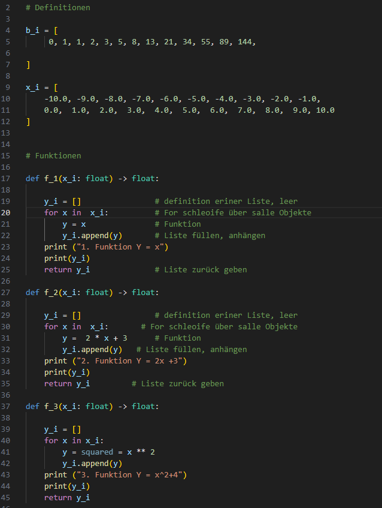

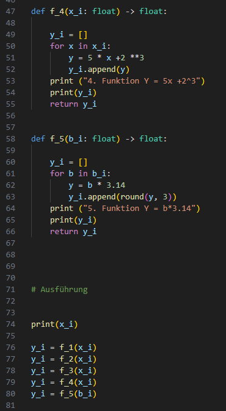


### Meine Notiz

|Debug|-
|---|---|
|F5|Starten|
|F9|Breakpoint|
|F10|durchlaufen|
|F11|In Funktion springen|

|Befehle| -
|---|---|
|Print|Schreiben|
|def|Definieren/unterbefehle|
|append|Listen füllen/anhängen|
|for|for schleife|
|return|sendet Wert zurück|
### Feedback

Jonas, das sieht schon sehr gut aus. Alle Funktionen sind definiert und die Ergebnisse werden geordnet ausgegeben. Prima

## Aufgabe 2

Neben Python gehört heutzutage "git" und "GitHub" zu den wichtigsten Werkzeugen eines Software Entwicklers.

Hier Deine Aufgabe:

- a) Erstelle Dir einen eigenen Account auf https://github.com . Lass' Dir von ChatGPT helfen, einen geeigneten Usernamen zu wählen. Der Username wird Deine Identität auf der weltweiten Plattform "GitHub" sein und ist nicht veränderbar.
- b) Schreibe mir per Teams Deinen Usernamen.

Dann werde ich Dir Schreibzugriff auf dieses Repository geben und auf Dich zukommen, damit wir gemeinsam Deine Lösung von Aufgabe 1 in dieses Repository hinzufügen.

### Feedback

Du hast erfolgreich ein git clone und ein Commit/ push gemacht. Kannst du die Konsolen Befehle hierzu noch angeben?


## Aufgabe 3

- a) Kopiere die Datei `aufgabe_1.py` und nenne die Kopie `aufgabe_3.py`.
- b) Ändere die Kopie so, dass sie anstelle einer Wertetabelle ein Diagramm erzeugt, welches alle drei Graphen $f_i(x)$ mit $i = {1, 2, 3}$ darstellt.

Nutze dazu das Modul `matplotlib`. Einen Einstieg dazu bekommst Du im [Getting Started](https://matplotlib.org/stable/users/getting_started/) 

Dazu muss du das Module matplotlib holen. In der Console den Befehl einbinden:

```
pip install matplotlib
```

Dann das Modul über ein import einbinden. Siehe Link oben.

```import matplotlib.pyplot as plt```


Bitte mache folgende Erweiterung:

- c) Das Fenster soll ein weiteres Diagramm haben, also insgesamt zwei. Das neue Diagramm soll die Graphen der selben Funktionen zeigen, jedoch als Datenpunkte und nicht als durchgezogene Linien. Weiterhin soll das Diagramm Gitternetzlinien haben, damit man sich besser orientieren kann. Die Achsen sollen durch den Punkt $(0, 0)$ gehen, also das typischen Achsenkreuz, wie wir es aus der Schule kennen. 


### Deine Lösung:

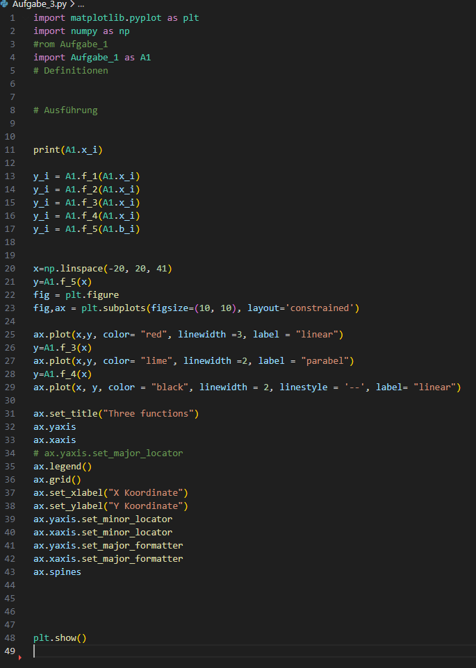   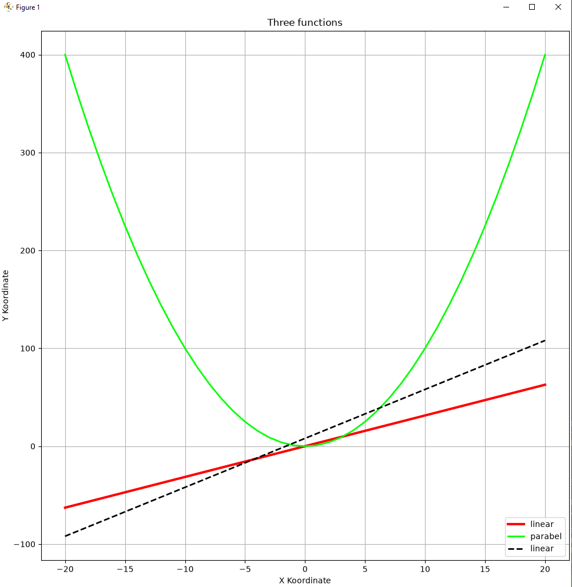


### Feedback


## Aufgabe 4

Installiere eine eigene virtuelle Umgebung (.venv) in deinem Projekt. Dazu wird scoop Verwendet. Ein großer Vorteil davon ist, das dein python mit im Projekt liegt, z.B. derren Version dort festgehalten sind und man sehr schnell diese venv wieder herstellen kann.

Commands:

uv über scoop installieren (einmalig):

```
scoop install uv
```

Im Projektordner die Umgebung bauen:
```
cd C:\Workspace\JonasLearnsPython
uv python install 3.13     # holt ein eigenes Python 3.13 (optional, siehe unten)
uv sync                    # legt .venv an UND installiert matplotlib + numpy
```

Die .venv als Standard Intergreter setzten: In settings.json
```
    "python.defaultInterpreterPath": "${workspaceFolder}/.venv/Scripts/python.exe",
```

Dann VS Code neu starten oder F1 + Reload Window eingeben. Prüfen ob der korrekte Interpreter gesetzt ist.

## Aufgabe 5

In Aufgabe 3 hast Du Deine Funktionen gezeichnet. Ein Diagramm ist aber erst dann wirklich gut, wenn ein anderer Mensch es verstehen kann, **ohne** dass Du daneben stehst und es erklärst. Genau das machen wir jetzt: aus dem Diagramm wird eine fertige Abbildung, so wie Du sie in einem Physik-Protokoll oder einem Buch finden würdest.

- a) Kopiere die Datei `Aufgabe_3.py` und nenne die Kopie `Aufgabe_5.py`.

Erweitere die Kopie dann Schritt für Schritt:

- b) **Beschriftung:** Gib dem Diagramm eine Überschrift und beschrifte beide Achsen (`x` und `y`).
- c) **Legende:** Zeichne mehrere Funktionen in *ein* Diagramm. Jede Kurve bekommt beim Zeichnen einen Namen, und das Diagramm bekommt eine Legende, damit man die Kurven unterscheiden kann.
- d) **Aussehen:** Gib jeder Kurve eine eigene Farbe und einen eigenen Linienstil (z.B. durchgezogen, gestrichelt, gepunktet) und mache die Linien etwas dicker.
- e) **Ausschnitt:** Lege selbst fest, welcher Bereich der x- und y-Achse zu sehen ist. Probiere aus, was passiert, wenn Du den Bereich der y-Achse auf $-20$ bis $20$ begrenzt, obwohl $f_3(x) = x^2$ bei $x = 10$ schon den Wert $100$ hat.
- f) **Besonderen Punkt markieren:** Suche Dir einen interessanten Punkt aus (z.B. den Schnittpunkt zweier Graphen oder den tiefsten Punkt der Parabel), zeichne dort einen dicken Punkt hin und schreibe mit einem Pfeil einen kurzen Text daneben.
- g) **Speichern:** Speichere das fertige Diagramm als Bilddatei `aufgabe_5.png` in Deinem Projektordner — und zwar aus dem Programm heraus, nicht mit der Maus über den Speichern-Knopf im Fenster.

### Hinweise

Alle neuen Befehle gehören zum `ax`-Objekt, das Du schon aus Aufgabe 3 kennst (`fig, ax = plt.subplots()`). Hier die Stichworte, den Rest findest Du in der Dokumentation:

```python
ax.plot(x, y, label="f_1(x) = x", color="blue", linestyle="--", linewidth=2)
ax.set_title("...")
ax.set_xlabel("...")
ax.set_ylabel("...")
ax.set_xlim(...)
ax.set_ylim(...)
ax.legend()
ax.annotate("...", xy=(0, 0), xytext=(3, 10), arrowprops={"arrowstyle": "->"})

fig.savefig("aufgabe_5.png", dpi=150)
```

Nachschlagen kannst Du das hier:

- [Beschriftungen und Legende](https://matplotlib.org/stable/users/explain/quick_start.html#labelling-plots)
- [Linienstile und Farben](https://matplotlib.org/stable/gallery/lines_bars_and_markers/linestyles.html)
- [Text und Pfeile (annotate)](https://matplotlib.org/stable/users/explain/text/annotations.html)
- [Abbildung speichern](https://matplotlib.org/stable/api/figure_api.html#matplotlib.figure.Figure.savefig)

**Wichtig:** `fig.savefig(...)` muss **vor** `plt.show()` stehen. Überlege Dir, woran das liegen könnte — das ist eine typische Stolperfalle.

**Tipp zur Reihenfolge:** Mache immer nur *eine* Änderung und starte das Programm danach direkt neu (F5). So siehst Du sofort, was der neue Befehl bewirkt, und weißt bei einem Fehler genau, welche Zeile schuld ist.

### Deine Lösung:
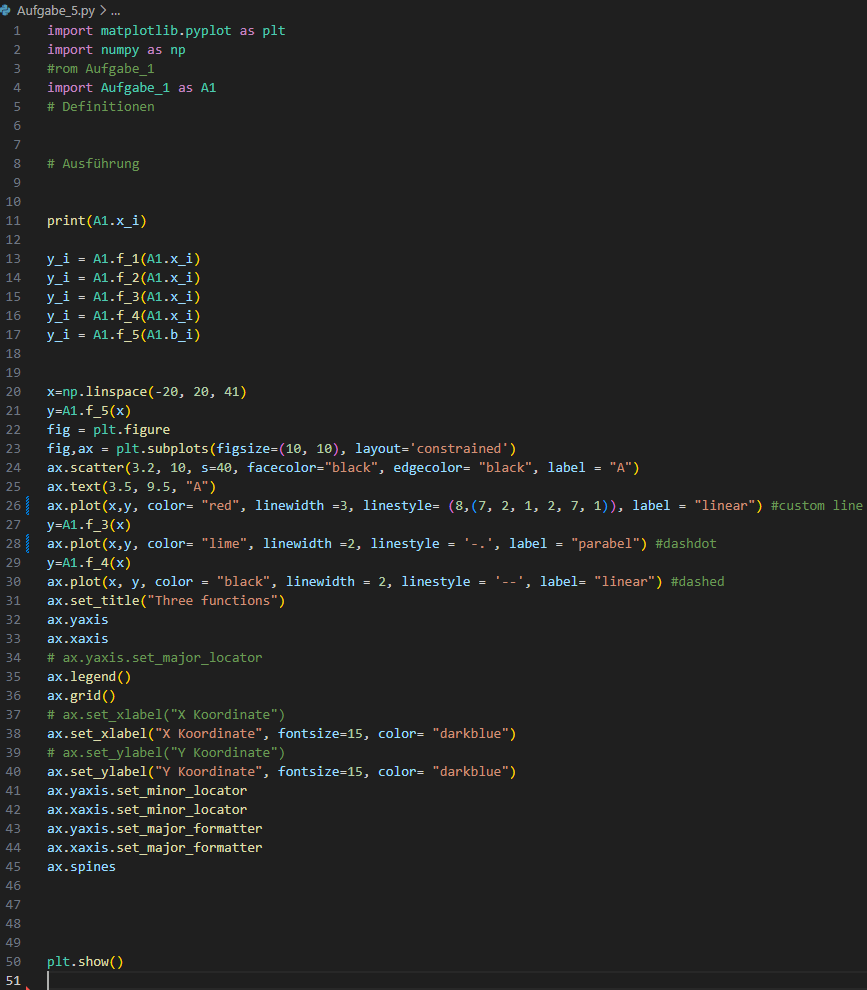   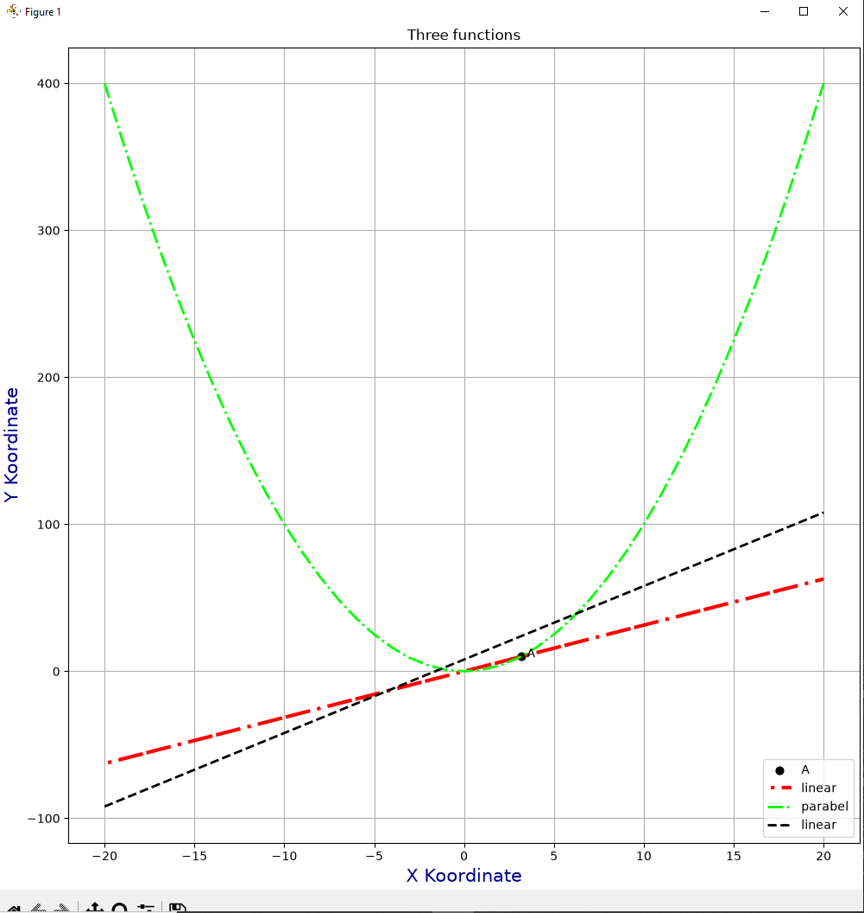

## Aufgabe 6

Bisher waren Deine Diagramme flach — zwei Achsen, $x$ und $y$. Jetzt kommt eine dritte Achse dazu. Das ist genau die Welt, in der auch die Schweißnaht-Scans später leben: ein Scanner liefert keine Kurve, sondern eine **Punktewolke**, also tausende Messpunkte mit je einer $x$-, $y$- und $z$-Koordinate.

Damit Du das üben kannst, liegt im Projekt die Datei `tiergesicht.obj`. Was da drin steckt, findest Du selbst heraus — schau sie Dir ruhig erst mal in VS Code an.

- a) Lege eine neue Datei `Aufgabe_6.py` an.

### Teil 1: Eine Fläche im Raum

Zum Aufwärmen zeichnest Du eine mathematische Funktion mit *zwei* Eingaben: $z = f(x, y)$. Statt einer Kurve kommt dabei eine gewölbte Fläche heraus.

- b) Erzeuge ein 3D-Diagramm und zeichne die Funktion $z = x^2 + y^2$ als Fläche. Das ist ein "Paraboloid" — eine Parabel, die um die $z$-Achse gedreht wurde.
- c) Probiere danach eine zweite Funktion aus, z.B. $z = \sin(x) \cdot \cos(y)$. Die sieht aus wie ein Eierkarton.

Dafür brauchst Du zwei neue Dinge. Erstens eine 3D-Achse:

```python
fig = plt.figure()
ax = fig.add_subplot(projection="3d")
```

Zweitens ein **Gitter** aus x- und y-Werten. `np.meshgrid` macht aus zwei Listen ein Raster, das jeden x-Wert mit jedem y-Wert kombiniert:

```python
x = np.linspace(-5, 5, 60)
y = np.linspace(-5, 5, 60)
X, Y = np.meshgrid(x, y)
Z = X**2 + Y**2

ax.plot_surface(X, Y, Z, cmap="viridis")
```

> **Denkaufgabe:** Lass Dir `X` und `Y` einmal mit `print` ausgeben. Warum sind das keine Listen mehr, sondern Tabellen? Und warum braucht man das, um eine Fläche zu zeichnen?

### Teil 2: Die Punktewolke

- d) Lies die Datei `tiergesicht.obj` in Deinem Programm ein. Jede Zeile, die mit `v ` beginnt (*v* wie *vertex*, englisch für Eckpunkt), enthält einen Punkt mit drei Zahlen. Zeilen, die mit `#` oder `o` beginnen, sind Kommentare bzw. ein Name — die überspringst Du.
- e) Sammle die Zahlen in drei Listen `x`, `y` und `z`.
- f) Zeichne alle Punkte mit `ax.scatter(x, y, z)` in ein 3D-Diagramm. Wähle eine kleine Punktgröße, sonst klebt alles zusammen: `s=1`.
- g) Beschrifte die drei Achsen und gib dem Diagramm einen Titel.
- h) Färbe die Punkte nach ihrer Höhe ein: `c=z, cmap="viridis"`. Probiere auch `c=y` aus — was wird dann sichtbar, was vorher nicht zu sehen war?

Eine Datei liest man in Python so:

```python
x = []
y = []
z = []

with open("tiergesicht.obj") as datei:
    for zeile in datei:
        if zeile.startswith("v "):
            teile = zeile.split()      # zerlegt "v 1.0 -0.5 0.3" in Einzelteile
            x.append(float(teile[1]))  # teile[0] ist das "v" selbst
            y.append(float(teile[2]))
            z.append(float(teile[3]))

print("Punkte eingelesen:", len(x))
```

Das `with open(...)` ist neu: es öffnet die Datei und schließt sie hinterher automatisch wieder. `float(...)` wandelt den Text `"1.0"` in eine echte Zahl um — ohne das würdest Du Buchstaben addieren statt Zahlen.

### Teil 3: Richtig hinschauen

Wenn Du das Diagrammfenster offen hast, kannst Du die Wolke **mit der Maus drehen**. Probier das aus, das ist der halbe Spaß an 3D.

- i) Sorge dafür, dass die drei Achsen gleich lang sind, sonst ist das Gesicht verzerrt: `ax.set_box_aspect((1, 1, 1))`.
- j) Stelle den Startblickwinkel so ein, dass man das Tier von vorne anschaut: `ax.view_init(elev=10, azim=-90)`. Spiele mit beiden Zahlen und finde heraus, was `elev` und was `azim` bedeutet.
- k) **Welches Tier ist es?** Schreibe Deine Antwort unten bei "Deine Lösung" hin.

### Zum Nachschlagen

- [3D-Diagramme in matplotlib](https://matplotlib.org/stable/users/explain/toolkits/mplot3d.html)
- [3D-Punktwolke (scatter)](https://matplotlib.org/stable/gallery/mplot3d/scatter3d.html)
- [3D-Fläche (plot_surface)](https://matplotlib.org/stable/gallery/mplot3d/surface3d.html)
- [Farbskalen (colormaps)](https://matplotlib.org/stable/users/explain/colors/colormaps.html)

**Tipp:** Fange klein an. Lass Dir erst mit `print(len(x))` zeigen, dass das Einlesen überhaupt geklappt hat, bevor Du ans Zeichnen gehst. Wenn da `0` steht, stimmt etwas mit dem Einlesen nicht — dann hilft Dir kein Diagramm weiter.

### Bonus

- l) Zeichne nur jeden zehnten Punkt (`x[::10]`). Ab wann erkennt man das Tier nicht mehr?
- m) Zeige die Fläche aus Teil 1 und die Punktewolke aus Teil 2 nebeneinander in **einem** Fenster. Den Befehl dafür kennst Du schon aus Aufgabe 3.

### Deine Lösung:

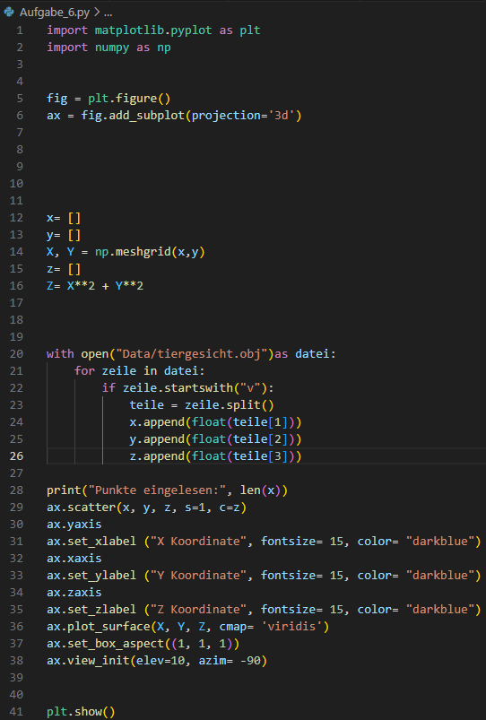
 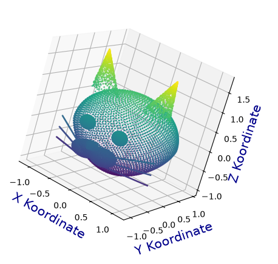


### Feedback

Super! Es ist doch toll, wenn etwas funktioniert.


## Aufgabe 7

Starte das SoftwareCenter auf deinem PC und installiere MashLab - dies ist ein Programm für die Darstellung von 3D Daten. Du kannst einfach die obj Dateien hineinziehen und Anzeigen und Betrachten. Schau Dir mal die Option an - vielleicht ist da etwas gutes dabei, was du auch in deinem matplotlib Viewer einbauen könntest.

### Deine Lösung:

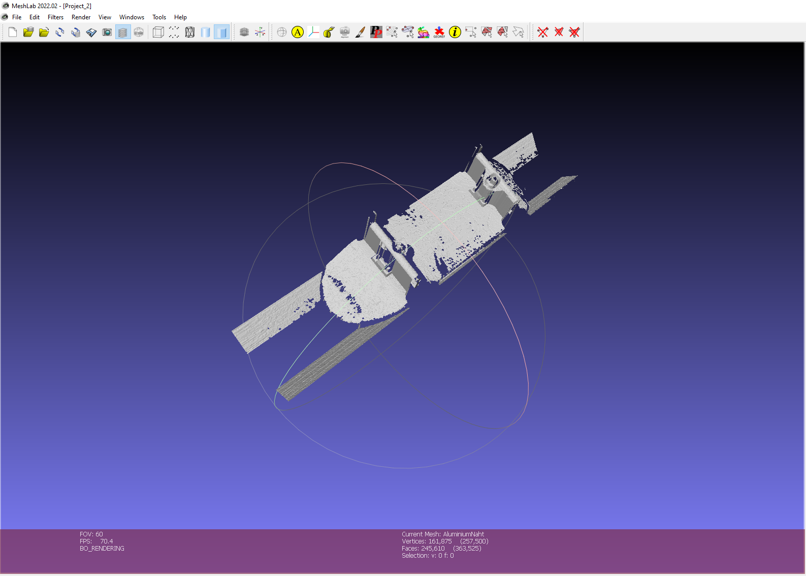

### Feedback

In diesem Program sieht das Skateboard besser aus, da es korrekt i Seitenverhältnis angezeigt wird. Dazu wird eine skalierung verwenden, also eine Rechvorschrift wieviel mm jeder Pixel darstellt.

## Aufgabe 8

Lege ein neues python an.

Kannst du probieren auch die selbst gescannten Objekte zu zeichnen. 
Werden dies gut angezeigt? Ist der Viewer noch bedienbar?
Was könnte man verbessern?

a) Probiere Punkte welche auf z=0 liegen nicht zu zeichnen

b) Kannst du eine Unterabtastung einbauen

c) Mache einen Screenshot vom Ergbniss und lege diesen in _figures ab. Binde diesen unter 'Deine Lösung' ein. Bsp. siehe Katze. Schreibe auf was du verbessert hast. 

### Deine Lösung:

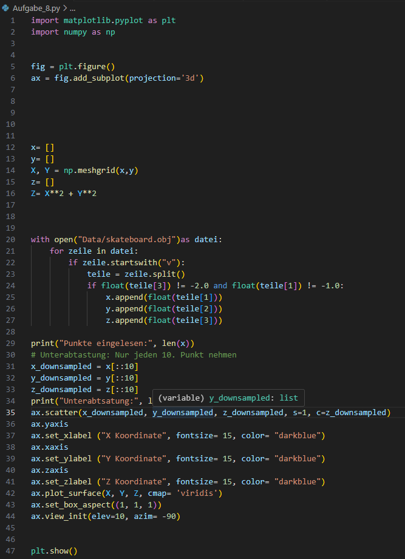 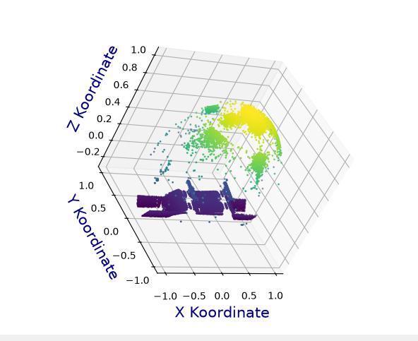 

### Feedback

Super, du hast die Artefakte ausgeblendet. Das Board ist noch verzerrt, aber mit fanasie erkennen wir es.


## Aufgabe 9

Erstelle einen Scan im Bodyloop Scanner und stelle ihn hier mit deinm code dar. Lege dazu ein Aufgabe_9.py an.


### Deine Lösung


### Feedback

## Aufgabe 10

Bisher hast Du die Scans als Punktewolke im Raum gezeichnet. Jetzt drehen wir den Spieß um und machen daraus ein **Bild** — denn genau so arbeitet die Schweißnahtinspektion wirklich.

Der Trick dahinter: ein Scanner wirft die Punkte nicht wild durcheinander ins Blickfeld. Er fährt Zeile für Zeile über das Objekt, wie ein Drucker. Die Punkte liegen also auf einem **Raster**. Und ein Raster aus Höhenwerten ist nichts anderes als ein Bild — nur dass jeder Bildpunkt keine Farbe speichert, sondern eine **Höhe**. Man nennt das ein *Höhenbild*.

Sobald Du dieses Bild hast, kannst Du damit alles machen, was die Bildverarbeitung kann: die höchste Stelle suchen, Kanten finden, Fehler erkennen.

- a) Lege eine neue Datei `Aufgabe_10.py` an. Nimm `Data/Skateboard.obj` — das kennst Du schon aus Aufgabe 8.

### Teil 1: Aus der Punktewolke ein Bild machen

- b) Lies die Datei ein wie bisher, in die drei Listen `x`, `y` und `z`. **Achtung:** diesmal darfst Du *keine* Punkte wegwerfen — auch nicht die ungültigen. Überlege Dir selbst, warum das Raster kaputtgeht, sobald Du einen einzigen Punkt löschst.
- c) Finde heraus, wie groß das Raster ist. `np.unique(x)` gibt Dir alle *verschiedenen* x-Werte zurück — die Anzahl davon ist die Zahl der Spalten. Genauso für die Zeilen.
- d) Prüfe mit `print`, ob `Spalten * Zeilen` genau die Anzahl Deiner Punkte ergibt. Wenn nicht, stimmt etwas mit dem Einlesen nicht, und alles Weitere wäre Unsinn.
- e) Forme die z-Liste mit `.reshape(...)` in dieses Raster um.
- f) Die ungültigen Messwerte (`-2.0`) musst Du jetzt **markieren statt löschen**: setze sie auf `np.nan` ("not a number"). matplotlib lässt solche Stellen einfach weiß.
- g) Zeige das Bild mit `ax.imshow(bild)` an und hänge eine Farbskala daneben, damit man die Höhen ablesen kann.

```python
spalten = len(np.unique(x))
zeilen  = len(np.unique(y))
print(spalten, "x", zeilen, "=", spalten * zeilen, "| Punkte:", len(z))

bild = np.array(z).reshape(spalten, zeilen).T
bild[bild == -2.0] = np.nan

im = ax.imshow(bild, cmap="viridis")
fig.colorbar(im, ax=ax, label="Höhe z")
```

> **Warum das `.T` am Ende?** `.T` heißt "transponieren" und kippt die Tabelle über Eck — aus Zeilen werden Spalten. Lass es einmal weg und schau Dir an, was passiert. Dann weißt Du, wofür es gut ist.

> **Noch eine Eigenheit:** bei `imshow` zeigt die y-Achse nach **unten**. Zeile 0 ist oben. Das ist bei Bildern immer so und verwirrt am Anfang jeden.

### Teil 2: Die Höhe erkennen

- h) Suche die **höchste Stelle** im Bild. Weil im Bild `np.nan`-Werte stehen, brauchst Du `np.nanargmax` — das normale `argmax` kommt mit `nan` nicht klar und liefert Unsinn.
- i) `np.nanargmax` gibt Dir nur eine einzige Zahl zurück, als wäre das Bild eine lange Kette. Mit `np.unravel_index` rechnest Du sie in Zeile und Spalte um.
- j) Zeichne an dieser Stelle einen **roten Punkt** ins Bild und schreibe mit einem Pfeil daran, was er bedeutet.
- k) Mache dasselbe für die tiefste Stelle, in einer anderen Farbe.

```python
zeile, spalte = np.unravel_index(np.nanargmax(bild), bild.shape)
print("höchster Punkt:", bild[zeile, spalte])

ax.plot(spalte, zeile, "ro", markersize=10)
ax.annotate("höchster Punkt", xy=(spalte, zeile), xytext=(spalte + 60, zeile - 30),
            color="red", arrowprops={"arrowstyle": "->", "color": "red"})
```

Pass hier auf die **Reihenfolge** auf: `unravel_index` liefert erst die Zeile, dann die Spalte. `ax.plot` will es andersherum — erst waagerecht, dann senkrecht. Wenn Dein Punkt an einer völlig falschen Stelle landet, ist fast immer das die Ursache.

### Teil 3: Ein Schnitt durch das Objekt

Ein Höhenbild von oben verrät Dir nicht, wie steil etwas ist. Dafür schneidet man das Objekt auf und schaut sich das Profil an — wie bei einer Landkarte mit Höhenprofil.

- l) Nimm die **mittlere Zeile** des Bildes heraus: `profil = bild[zeilen // 2, :]`. Das ist eine ganz normale Liste von Höhenwerten.
- m) Zeichne dieses Profil in ein **zweites Diagramm** unter das Höhenbild (zwei Diagramme in einem Fenster kennst Du aus Aufgabe 3).
- n) Zeichne in das Höhenbild eine **waagerechte Linie** dort ein, wo Du geschnitten hast — damit man sieht, woher das Profil stammt: `ax.axhline(zeilen // 2, color="red", linestyle="--")`.
- o) Erkennst Du im Profil die Form des Skateboards wieder? Wo sind die Achsen (die Rollenhalterungen)?

### Teil 4: Kanten erkennen

Eine Kante ist eine Stelle, an der sich die Höhe **plötzlich stark ändert**. Mathematisch: eine große Steigung. Genau das rechnet `np.gradient` aus — für jeden Bildpunkt, wie stark sich der Wert zum Nachbarn hin ändert.

- p) Berechne das Kantenbild: `kante = np.abs(np.gradient(bild, axis=1))`. Das `np.abs` macht alle Werte positiv — ob es bergauf oder bergab geht, ist für eine Kante egal.
- q) Zeige das Kantenbild in einem dritten Diagramm an, am besten in Graustufen (`cmap="gray"`). Helle Stellen sind Kanten.
- r) Probiere `axis=0` statt `axis=1`. Welche Kanten findest Du dann, und welche verschwinden? Erkläre Dir selbst, warum.
- s) Entscheide Dich für eine **Schwelle**: alles über einem bestimmten Wert gilt als Kante, alles darunter nicht. `kante > 0.002` gibt Dir ein Bild aus lauter Ja/Nein-Werten. Spiele mit der Zahl — wird sie zu klein, ist alles Kante; wird sie zu groß, findest Du nichts mehr.
- t) Zeichne zum Schluss **senkrechte Linien** (`ax.axvline(...)`) dort ins Höhenbild, wo Du die beiden Achsen des Skateboards vermutest.

> **Das ist der Kern jeder Fehlererkennung:** Ein Computer "sieht" keinen Kratzer und keine schlechte Schweißnaht. Er rechnet nur aus, wo sich etwas stärker ändert als erwartet — und vergleicht das mit einer Schwelle. Die Kunst steckt darin, die richtige Schwelle zu finden.

### Zum Nachschlagen

- [Bilder anzeigen (imshow)](https://matplotlib.org/stable/api/_as_gen/matplotlib.axes.Axes.imshow.html)
- [Farbskala (colorbar)](https://matplotlib.org/stable/api/figure_api.html#matplotlib.figure.Figure.colorbar)
- [Hilfslinien (axhline / axvline)](https://matplotlib.org/stable/api/_as_gen/matplotlib.axes.Axes.axhline.html)
- [numpy: reshape](https://numpy.org/doc/stable/reference/generated/numpy.reshape.html)
- [numpy: gradient](https://numpy.org/doc/stable/reference/generated/numpy.gradient.html)

**Tipp:** Arbeite die vier Teile nacheinander ab und mache nach jedem einen Screenshot. Wenn Teil 1 nicht stimmt, ist alles Weitere wertlos — das Bild muss *vorher* richtig aussehen, bevor Du anfängst, darin zu suchen.

### Bonus

- u) Lass dasselbe Programm auf `Data/AluminiumNaht.obj` laufen. Die Naht ist viel flacher als das Skateboard — Du wirst die Farbskala anpassen müssen, sonst siehst Du nichts. Im Kantenbild ist eine auffällige Stelle zu finden. Markiere sie mit einem Punkt. Was könnte das sein?
- v) Schreibe das Einlesen als **Funktion** `lade_hoehenbild(dateiname)`, die das fertige Bild zurückgibt. Dann kannst Du die Scans wechseln, ohne jedes Mal den Code umzubauen.

### Deine Lösung:


### Feedback

